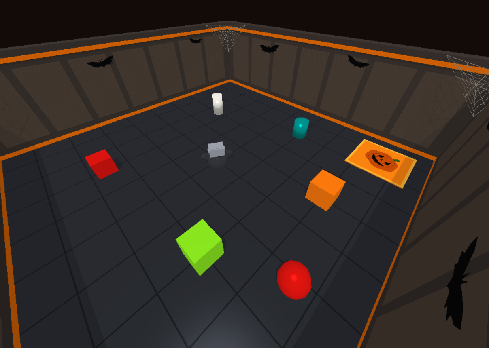
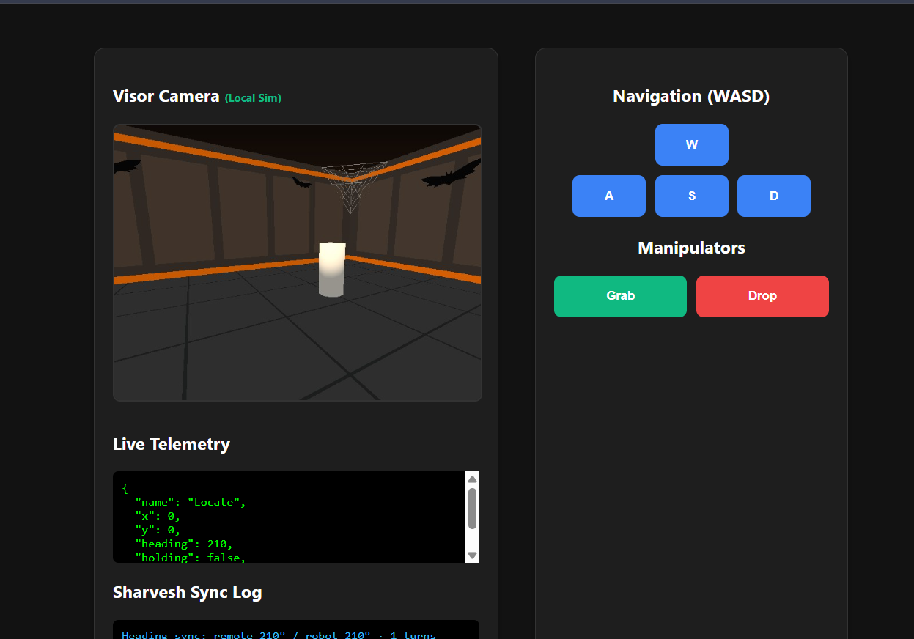
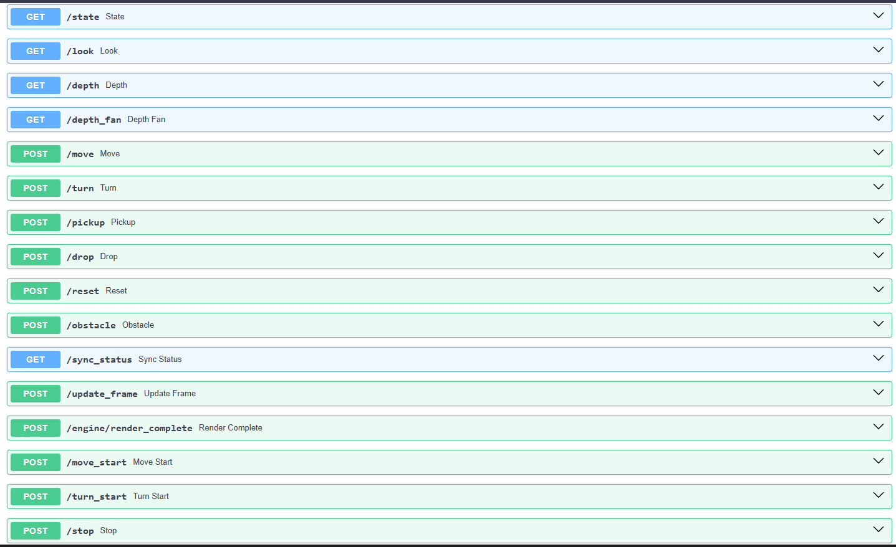

# 🤖 Humanoid Robot Control API & Simulation Arena

[](https://www.python.org/)
[](https://fastapi.tiangolo.com/)
[](https://pybullet.org/)

A distributed robotics backend and 3D simulation environment built for multi-agent coordination. This project couples a high-performance **FastAPI** control server with a **PyBullet** physics simulation engine (`sim_engine.py`) to manage humanoid robot kinematics, collision detection, sensor streams, and object manipulation tasks.

---

## 🖼️ Visual Preview & Dashboard

### 1. 3D Simulation Arena (PyBullet Viewport)
The environment features a custom-built arena complete with dynamic obstacles, target objects, and drop zones governed by PyBullet's 3D physics engine.


### 2. Control Dashboard & Live Telemetry
Provides a real-time monitoring interface tracking live coordinates (`x`, `y`), robot heading, holding states, and integrated WASD navigation / manipulator controls.


### 3. FastAPI Interactive Documentation (Swagger UI)
Cleanly structured REST endpoints for state telemetry, sensor depth arrays, velocity tracking, and actuator controls.


---

## 🛠️ Architecture & Tech Stack
* **Backend & Routing:** Python, FastAPI, Uvicorn (Asynchronous REST API)
* **Physics & Simulation:** PyBullet, OpenGL, NumPy (Rigid body dynamics, collision mapping, raycasting)
* **Validation & Networking:** Pydantic (Strict request/response validation), Requests (Inter-node synchronization with peer servers)
* **Modular Design:** Encapsulated packages for arena scenes (`sim/scene.py`), kinematics/drivers (`sim/driver.py`), referee scoring (`sim/referee.py`), and depth/vision sensors (`sim/sensors.py`).

---

## 📡 Complete API Endpoints Reference

### Telemetry & Vision
* **`GET /state`** — Returns current robot telemetry (`name`, coordinates `x`, `y`, `heading`, `holding`, `collided`, `retries`).
* **`GET /look`** — Captures a local PyBullet camera frame, forwards the base64 payload to peer nodes (e.g., Sharvesh's server), and returns a JPEG response.
* **`GET /depth` & `GET /depth_fan`** — Returns single or fan-out distance ray data used for autonomous obstacle avoidance.

### Discrete Actuator Control
* **`POST /move`** — Commands the robot to move forward or backward by a specified distance with built-in collision back-off handling.
* **`POST /turn`** — Rotates the robot by specified degrees.
* **`POST /pickup`** — Initiates proximity checks and kinematic constraints to grab target objects within reach.
* **`POST /drop`** — Places held objects down into designated drop zones.

### Simulation & State Management
* **`POST /reset`** — Resets the simulation arena, robot position, and object spawns.
* **`POST /obstacle`** — Toggles dynamic obstacle mode within the arena.
* **`GET /sync_status`** — Synchronizes states across distributed teammates' nodes.

### Continuous Velocity & Motion
* **`POST /move_start`** — Starts continuous linear velocity movement.
* **`POST /turn_start`** — Starts continuous angular velocity rotation.
* **`POST /stop`** — Instantly halts active wheel movement.

---

## 🚀 Getting Started Locally

### 1. Clone the Repository
```bash
git clone [https://github.com/Roshni-07/HackOween_Codejuring.git](https://github.com/Roshni-07/HackOween_Codejuring.git)
cd HackOween_Codejuring
